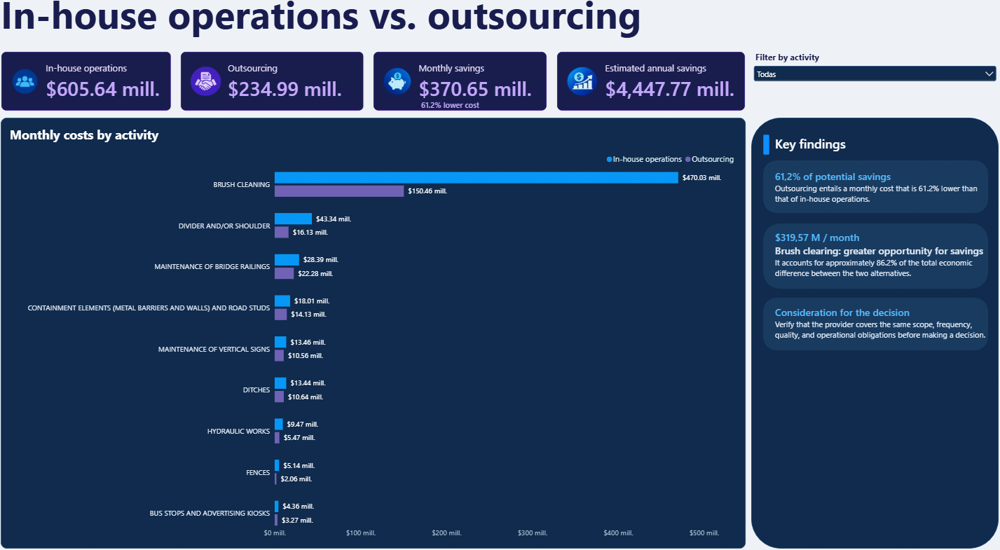

<!-- MAIN TITLE -->
<h1 align="center">📊 In-House Operations vs. Outsourcing — Cost Analysis</h1>

  An interactive <b>Power BI dashboard</b> comparing the monthly costs of <b>in-house operations</b> and <b>outsourcing</b> across operational activities. 
  The project highlights <b>potential cost savings</b>, supports <b>make-or-buy decisions</b>, and helps stakeholders evaluate opportunities for <b>operational efficiency</b>.

  
  
  

---

## 🧭 1. Introduction

Organizations often need to decide whether operational activities should be performed by internal teams or outsourced to specialized providers. A meaningful comparison requires visibility into **costs by activity**, **overall financial differences**, and the **trade-offs behind each option**.

This project presents an interactive **Power BI report** that compares two operating models—**in-house operations** and **outsourcing**—to reveal where the largest potential savings exist and support evidence-based operational planning.

**Business question:** *Which activities offer the greatest potential savings through outsourcing, and how significant is the overall cost difference?*

---

## 🎯 2. Project Objective

To develop an interactive cost-comparison dashboard that enables decision-makers to:

- Compare **monthly in-house and outsourcing costs** across operational activities
- Quantify **potential monthly and annual savings**
- Identify **high-impact activities** with the largest cost differences
- Explore the results using an **activity-level filter**
- Support **cost optimization and outsourcing decisions** with clear financial indicators

The report is intended as a **decision-support tool**, not as a recommendation to outsource every activity without further operational assessment.

---

## 🧪 3. What Was Done

### ✔ Comparative Cost Analysis
- Compared estimated **monthly costs** under two operating models
- Examined cost differences at both **total** and **individual activity** levels
- Summarized potential **monthly savings**, **percentage reduction**, and **annualized savings**

### ✔ Interactive Power BI Dashboard
Designed a Power BI report with four complementary components:

1. **KPI Cards — Cost and savings overview**
   - In-house operating costs, outsourcing costs, monthly savings, and estimated annual savings
2. **Clustered Horizontal Bar Chart — Monthly costs by activity**
   - Side-by-side comparisons that make differences between the two alternatives easy to identify
3. **Activity Filter — Focused exploration**
   - Allows users to review a selected activity or view the complete analysis
4. **Key Findings Panel — Decision-oriented storytelling**
   - Summarizes major savings opportunities and considerations before outsourcing

### ✔ Business Interpretation
- Identified the largest contributor to the observed cost difference
- Highlighted **scope, frequency, quality, and operational obligations** as factors to validate before a final decision

---

## 🛠️ 4. Tools & Technologies Used

- **Microsoft Power BI Desktop** — report development and interactive data visualization
- **Power BI report (.pbix)** — editable project file containing the report
- **KPI design and comparative analysis** — business performance assessment
- **Data storytelling** — communication of findings for decision-makers

---

## 📊 5. Key Results

### ✔ Overall Cost Comparison

| Indicator | Dashboard value |
|:--|--:|
| Monthly in-house operations cost | **$605.64 million** |
| Monthly outsourcing cost | **$234.99 million** |
| **Potential monthly savings** | **$370.65 million** |
| **Potential cost reduction** | **61.2%** |
| **Estimated annual savings** | **$4,447.77 million** |

*Values are transcribed from the Power BI dashboard. The screenshot shows a `$` symbol and amounts in millions, but does not specify the currency. Values are rounded as displayed; the annual estimate may therefore differ slightly from multiplying the rounded monthly savings by 12.*

### ✔ Largest Savings Opportunity: Brush Cleaning

- **In-house:** $470.03 million per month
- **Outsourcing:** $150.46 million per month
- **Potential difference:** **$319.57 million per month**
- This activity accounts for approximately **86.2% of the total monthly savings opportunity** shown in the report.

### ✔ Strategic Takeaway

The modeled outsourcing scenario shows a **61.2% lower overall monthly cost** than in-house execution. However, outsourcing decisions should also consider **service quality, provider capacity, activity scope, operating frequency, contractual terms, and execution risk**.

---

## 📊 6. Dashboard

An interactive **Power BI dashboard** was developed to compare in-house operational costs against outsourcing alternatives, identify potential savings, and support data-driven decision-making.

  

### Dashboard Features

- **Interactive activity filter** to explore individual operational activities.
- **KPI cards** displaying in-house costs, outsourcing costs, and potential monthly and annual savings.
- **Comparative bar chart** highlighting cost differences across activities.
- **Key findings panel** summarizing savings opportunities and strategic considerations.

The original **Power BI (.pbix) file** is available in this repository for further exploration.

---

## 🔍 7. Insights & Conclusions

- **Outsourcing presents a substantial potential cost advantage** in the scenario represented by the dashboard.
- **Brush Cleaning is the main savings driver**, making it the most important activity to investigate in a more detailed financial and operational assessment.
- **Activity-level comparisons** help distinguish major opportunities from smaller cost differences and support more focused decision-making.
- **Annualized savings are estimates**, assuming the monthly cost difference remains broadly consistent over 12 months.
- **Financial savings alone are not sufficient** to justify outsourcing: decisions should validate service-level expectations, quality standards, contractual scope, and operational risk.

### ✔ Business Value

This Power BI project demonstrates how **business intelligence**, **cost comparison**, and **clear data visualization** can turn operational cost figures into actionable insights for **resource allocation**, **efficiency planning**, and **make-or-buy evaluations**.
